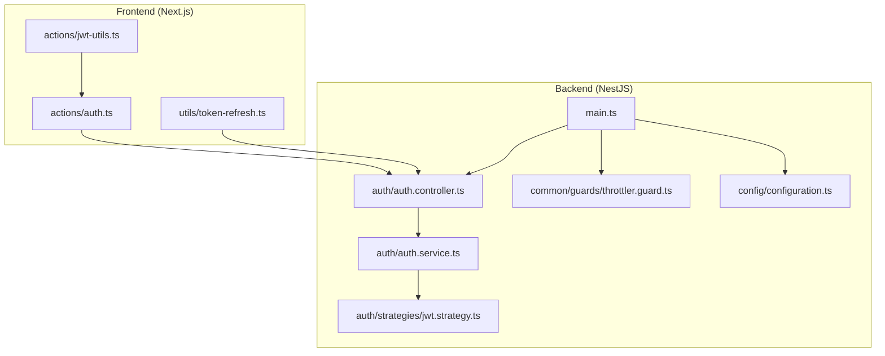
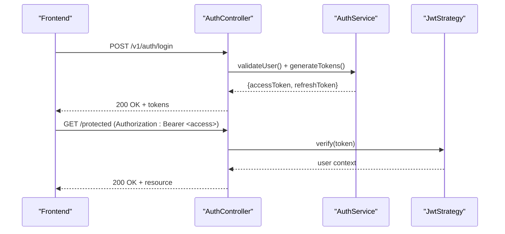
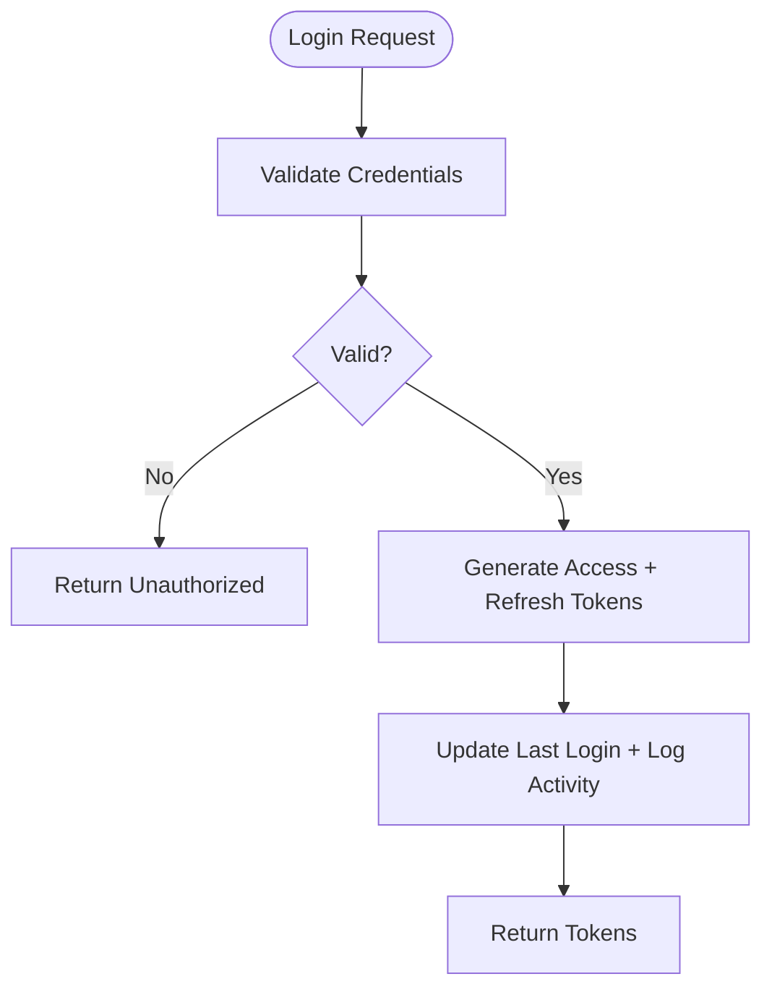
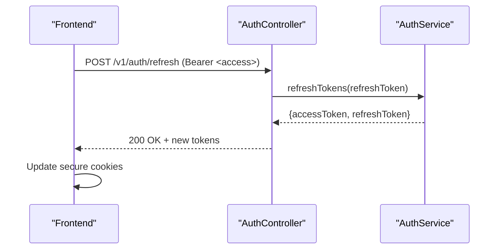
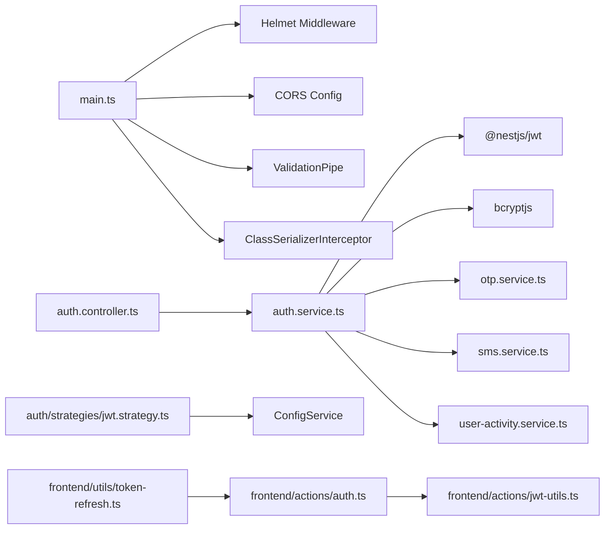

# Security Guide

<cite>
**Referenced Files in This Document**
- [main.ts](file://apps/backend/src/main.ts)
- [configuration.ts](file://apps/backend/src/config/configuration.ts)
- [auth.controller.ts](file://apps/backend/src/auth/auth.controller.ts)
- [auth.service.ts](file://apps/backend/src/auth/auth.service.ts)
- [jwt.strategy.ts](file://apps/backend/src/auth/strategies/jwt.strategy.ts)
- [throttler.guard.ts](file://apps/backend/src/common/guards/throttler.guard.ts)
- [jwt-utils.ts](file://apps/frontend/actions/jwt-utils.ts)
- [token-refresh.ts](file://apps/frontend/utils/token-refresh.ts)
- [auth.ts](file://apps/frontend/actions/auth.ts)
</cite>

## Table of Contents
1. Introduction
2. Project Structure
3. Core Components
4. Architecture Overview
5. Detailed Component Analysis
6. Dependency Analysis
7. Performance Considerations
8. Troubleshooting Guide
9. Conclusion
10. Appendices

## Introduction
This document provides a comprehensive security guide for the German Butcher e-commerce platform. It covers authentication and authorization (JWT, password hashing, session management via secure cookies, role-based access control), protection against common vulnerabilities (SQL injection, XSS, CSRF, input validation), data protection strategies (encryption at rest/in transit, secure cookie handling, privacy compliance), API security (security headers, CORS, rate limiting), secure coding practices, dependency vulnerability management, audits, payment security (PCI considerations, tokenization), incident response, monitoring, threat detection, and security testing approaches.

## Project Structure
The backend is a NestJS application that configures global security middleware, validates inputs, and exposes authenticated endpoints. The frontend is a Next.js application that manages tokens in secure HTTP-only cookies and performs client-side token decoding and refresh flows.

**Diagram sources**
- [main.ts:16-128](file://apps/backend/src/main.ts#L16-L128)
- [auth.controller.ts:31-309](file://apps/backend/src/auth/auth.controller.ts#L31-L309)
- [auth.service.ts:21-170](file://apps/backend/src/auth/auth.service.ts#L21-L170)
- [jwt.strategy.ts:6-25](file://apps/backend/src/auth/strategies/jwt.strategy.ts#L6-L25)
- [throttler.guard.ts:5-26](file://apps/backend/src/common/guards/throttler.guard.ts#L5-L26)
- [configuration.ts:1-15](file://apps/backend/src/config/configuration.ts#L1-L15)
- [auth.ts:55-157](file://apps/frontend/actions/auth.ts#L55-L157)
- [jwt-utils.ts:1-52](file://apps/frontend/actions/jwt-utils.ts#L1-L52)
- [token-refresh.ts:7-46](file://apps/frontend/utils/token-refresh.ts#L7-L46)

**Section sources**
- [main.ts:16-128](file://apps/backend/src/main.ts#L16-L128)
- [auth.controller.ts:31-309](file://apps/backend/src/auth/auth.controller.ts#L31-L309)
- [auth.service.ts:21-170](file://apps/backend/src/auth/auth.service.ts#L21-L170)
- [jwt.strategy.ts:6-25](file://apps/backend/src/auth/strategies/jwt.strategy.ts#L6-L25)
- [throttler.guard.ts:5-26](file://apps/backend/src/common/guards/throttler.guard.ts#L5-L26)
- [configuration.ts:1-15](file://apps/backend/src/config/configuration.ts#L1-L15)
- [auth.ts:55-157](file://apps/frontend/actions/auth.ts#L55-L157)
- [jwt-utils.ts:1-52](file://apps/frontend/actions/jwt-utils.ts#L1-L52)
- [token-refresh.ts:7-46](file://apps/frontend/utils/token-refresh.ts#L7-L46)

## Core Components
- Authentication controller and service: handle login, registration, OTP-based mobile login, token refresh, logout, and token validation.
- JWT strategy: validates bearer tokens using a secret from configuration.
- Global security middleware: Helmet, compression, body size limits, CORS, validation pipe, class serializer interceptor.
- Rate limiting: per-endpoint throttling decorators and a custom throttler guard with skip support.
- Frontend token handling: secure cookie storage, token decoding, expiration checks, and server-side token refresh.

Key responsibilities:
- Enforce least privilege via roles embedded in JWTs.
- Protect sensitive fields from serialization to responses.
- Validate all incoming payloads globally.
- Limit brute-force and abuse via throttling.
- Securely store tokens in HTTP-only cookies.

**Section sources**
- [auth.controller.ts:31-309](file://apps/backend/src/auth/auth.controller.ts#L31-L309)
- [auth.service.ts:54-170](file://apps/backend/src/auth/auth.service.ts#L54-L170)
- [jwt.strategy.ts:6-25](file://apps/backend/src/auth/strategies/jwt.strategy.ts#L6-L25)
- [main.ts:20-125](file://apps/backend/src/main.ts#L20-L125)
- [throttler.guard.ts:5-26](file://apps/backend/src/common/guards/throttler.guard.ts#L5-L26)
- [auth.ts:55-157](file://apps/frontend/actions/auth.ts#L55-L157)
- [jwt-utils.ts:1-52](file://apps/frontend/actions/jwt-utils.ts#L1-L52)
- [token-refresh.ts:7-46](file://apps/frontend/utils/token-refresh.ts#L7-L46)

## Architecture Overview
The system uses stateless JWTs for API authorization. Tokens are issued by the backend and stored in HTTP-only cookies on the frontend. Protected routes require a valid Bearer token. Refresh tokens allow reissuing short-lived access tokens without re-authentication.

**Diagram sources**
- [auth.controller.ts:81-114](file://apps/backend/src/auth/auth.controller.ts#L81-L114)
- [auth.service.ts:54-100](file://apps/backend/src/auth/auth.service.ts#L54-L100)
- [jwt.strategy.ts:6-25](file://apps/backend/src/auth/strategies/jwt.strategy.ts#L6-L25)

## Detailed Component Analysis

### Authentication and Authorization
- Login flow: validates credentials, generates access and refresh tokens, updates last login, logs activity.
- Mobile OTP flow: validates mobile number format, enforces resend cooldown, stores OTP with expiry, sends SMS, verifies OTP, issues tokens.
- Token refresh: verifies refresh token with a separate secret, returns new tokens.
- Logout: records logout activity; clients must discard tokens.
- Role-based access control: roles are embedded in JWT payload and used to determine admin privileges.

**Diagram sources**
- [auth.service.ts:54-100](file://apps/backend/src/auth/auth.service.ts#L54-L100)

**Section sources**
- [auth.controller.ts:81-114](file://apps/backend/src/auth/auth.controller.ts#L81-L114)
- [auth.controller.ts:116-150](file://apps/backend/src/auth/auth.controller.ts#L116-L150)
- [auth.controller.ts:152-195](file://apps/backend/src/auth/auth.controller.ts#L152-L195)
- [auth.service.ts:54-170](file://apps/backend/src/auth/auth.service.ts#L54-L170)
- [auth.service.ts:172-358](file://apps/backend/src/auth/auth.service.ts#L172-L358)
- [jwt.strategy.ts:6-25](file://apps/backend/src/auth/strategies/jwt.strategy.ts#L6-L25)

### Password Hashing
- Passwords are hashed using bcryptjs during registration and verified during login.
- Sensitive fields (password, OTP) are sanitized before returning user data.

Security notes:
- Ensure appropriate bcrypt cost factor in production.
- Avoid logging or exposing hashes.

**Section sources**
- [auth.service.ts:54-73](file://apps/backend/src/auth/auth.service.ts#L54-L73)
- [auth.service.ts:102-105](file://apps/backend/src/auth/auth.service.ts#L102-L105)

### Session Management and Secure Cookies
- Tokens are stored in HTTP-only cookies with SameSite=Lax and HTTPS-only in production.
- User profile metadata is also stored in an HTTP-only cookie for UI rendering.
- Token refresh endpoint is called server-side to avoid exposing tokens to client scripts.

**Diagram sources**
- [auth.controller.ts:116-150](file://apps/backend/src/auth/auth.controller.ts#L116-L150)
- [auth.service.ts:107-144](file://apps/backend/src/auth/auth.service.ts#L107-L144)
- [token-refresh.ts:7-46](file://apps/frontend/utils/token-refresh.ts#L7-L46)
- [auth.ts:55-157](file://apps/frontend/actions/auth.ts#L55-L157)

**Section sources**
- [auth.ts:55-157](file://apps/frontend/actions/auth.ts#L55-L157)
- [token-refresh.ts:7-46](file://apps/frontend/utils/token-refresh.ts#L7-L46)

### Input Validation and Sanitization
- Global ValidationPipe with whitelist and transform enabled ensures only allowed fields pass through.
- DTOs define expected shapes for auth endpoints.
- ClassSerializerInterceptor strips excluded fields (e.g., password, OTP) from responses.

**Section sources**
- [main.ts:111-125](file://apps/backend/src/main.ts#L111-L125)
- [auth.controller.ts:38-79](file://apps/backend/src/auth/auth.controller.ts#L38-L79)
- [auth.controller.ts:81-114](file://apps/backend/src/auth/auth.controller.ts#L81-L114)

### Rate Limiting and Abuse Prevention
- Per-endpoint throttling decorators protect login, register, mobile-login, and verify-otp.
- Custom ThrottlerGuard supports skipping throttle via decorator metadata.

Operational guidance:
- Tune limits based on traffic patterns.
- Monitor 429 responses and adjust thresholds.

**Section sources**
- [auth.controller.ts:38-40](file://apps/backend/src/auth/auth.controller.ts#L38-L40)
- [auth.controller.ts:81-83](file://apps/backend/src/auth/auth.controller.ts#L81-L83)
- [auth.controller.ts:231-240](file://apps/backend/src/auth/auth.controller.ts#L231-L240)
- [auth.controller.ts:269-276](file://apps/backend/src/auth/auth.controller.ts#L269-L276)
- [throttler.guard.ts:5-26](file://apps/backend/src/common/guards/throttler.guard.ts#L5-L26)

### API Security Headers and CORS
- Helmet enables recommended security headers.
- CORS configured via environment variables with explicit methods and headers; credentials supported.
- Body parser limits increased to accommodate checkout payloads.

Best practices:
- Restrict CORS origins to known domains in production.
- Keep Swagger disabled in production unless explicitly enabled.

**Section sources**
- [main.ts:20-35](file://apps/backend/src/main.ts#L20-L35)
- [main.ts:42-87](file://apps/backend/src/main.ts#L42-L87)
- [main.ts:89-109](file://apps/backend/src/main.ts#L89-L109)

### Data Protection Strategies
- Encryption in transit: enforce HTTPS/TLS at the reverse proxy/load balancer.
- Encryption at rest: ensure database encryption is enabled at the infrastructure level.
- Secrets management: use environment variables for secrets (JWT secrets, payment credentials).
- Privacy: minimize data exposure; strip sensitive fields from responses.

**Section sources**
- [configuration.ts:1-15](file://apps/backend/src/config/configuration.ts#L1-L15)
- [main.ts:111-125](file://apps/backend/src/main.ts#L111-L125)

### Payment Security
- Payment configuration includes SSLCommerz settings and redirect URLs.
- PCI compliance: do not store raw card data; rely on provider tokenization.
- Server-side verification of payment callbacks and idempotency keys.

Recommendations:
- Validate IPN/webhook signatures.
- Use HTTPS for all payment-related endpoints.
- Implement strict error handling and audit trails for payment events.

**Section sources**
- [configuration.ts:1-15](file://apps/backend/src/config/configuration.ts#L1-L15)

### Incident Response and Monitoring
- Login/logout actions are logged with IP, user agent, request ID, and session identifiers.
- Non-critical audit writes should not block authentication responses.

Response playbook:
- Detect anomalies via rate limit spikes and failed OTP attempts.
- Rotate compromised secrets immediately.
- Revoke sessions and force re-authentication if needed.

**Section sources**
- [auth.service.ts:382-431](file://apps/backend/src/auth/auth.service.ts#L382-L431)

### Security Testing Approaches
- Penetration testing: validate auth flows, token handling, and payment integrations.
- Vulnerability scanning: run SAST/DAST regularly; review dependencies.
- Code reviews: enforce security-focused checklists for PRs.
- OTP and throttling tests: simulate brute-force and replay attacks.

[No sources needed since this section provides general guidance]

## Dependency Analysis
The following diagram shows key runtime dependencies between components involved in authentication and security.

**Diagram sources**
- [main.ts:20-125](file://apps/backend/src/main.ts#L20-L125)
- [auth.controller.ts:31-309](file://apps/backend/src/auth/auth.controller.ts#L31-L309)
- [auth.service.ts:21-170](file://apps/backend/src/auth/auth.service.ts#L21-L170)
- [jwt.strategy.ts:6-25](file://apps/backend/src/auth/strategies/jwt.strategy.ts#L6-L25)
- [auth.ts:55-157](file://apps/frontend/actions/auth.ts#L55-L157)
- [jwt-utils.ts:1-52](file://apps/frontend/actions/jwt-utils.ts#L1-L52)
- [token-refresh.ts:7-46](file://apps/frontend/utils/token-refresh.ts#L7-L46)

**Section sources**
- [main.ts:20-125](file://apps/backend/src/main.ts#L20-L125)
- [auth.controller.ts:31-309](file://apps/backend/src/auth/auth.controller.ts#L31-L309)
- [auth.service.ts:21-170](file://apps/backend/src/auth/auth.service.ts#L21-L170)
- [jwt.strategy.ts:6-25](file://apps/backend/src/auth/strategies/jwt.strategy.ts#L6-L25)
- [auth.ts:55-157](file://apps/frontend/actions/auth.ts#L55-L157)
- [jwt-utils.ts:1-52](file://apps/frontend/actions/jwt-utils.ts#L1-L52)
- [token-refresh.ts:7-46](file://apps/frontend/utils/token-refresh.ts#L7-L46)

## Performance Considerations
- Compression reduces payload sizes for large lists.
- Body parser limits tuned for checkout payloads.
- Non-critical audit writes are fire-and-forget to avoid blocking auth responses.
- JWT signing is parallelized for access and refresh tokens.

[No sources needed since this section provides general guidance]

## Troubleshooting Guide
Common issues and resolutions:
- Invalid credentials: verify email/password and ensure bcrypt comparison is used.
- Invalid refresh token: confirm refresh secret and token expiry.
- OTP resend blocked: respect 60-second cooldown per mobile number.
- CORS errors: ensure origin list matches frontend domain and credentials are enabled.
- Swagger exposed in production: disable unless explicitly enabled via environment variable.

**Section sources**
- [auth.service.ts:54-73](file://apps/backend/src/auth/auth.service.ts#L54-L73)
- [auth.service.ts:107-144](file://apps/backend/src/auth/auth.service.ts#L107-L144)
- [auth.service.ts:204-218](file://apps/backend/src/auth/auth.service.ts#L204-L218)
- [main.ts:42-87](file://apps/backend/src/main.ts#L42-L87)
- [main.ts:89-109](file://apps/backend/src/main.ts#L89-L109)

## Conclusion
The platform implements robust authentication and authorization using JWTs, secure cookie storage, role-based access control, and strong input validation. Security headers, CORS, and rate limiting provide defense-in-depth. Payment integration relies on external providers to reduce PCI scope. Continuous monitoring, secure coding practices, and regular security testing will further harden the system.

[No sources needed since this section summarizes without analyzing specific files]

## Appendices

### Security Headers and CORS Configuration
- Helmet applied globally.
- CORS configured with explicit methods, headers, and credentials.
- Swagger disabled in production unless explicitly enabled.

**Section sources**
- [main.ts:28-35](file://apps/backend/src/main.ts#L28-L35)
- [main.ts:89-109](file://apps/backend/src/main.ts#L89-L109)
- [main.ts:42-87](file://apps/backend/src/main.ts#L42-L87)

### Secure Coding Practices
- Validate all inputs with DTOs and global pipes.
- Never log secrets or sensitive payloads.
- Use parameterized queries and ORM features to prevent SQL injection.
- Apply Content Security Policy and other CSP-related headers via Helmet.
- Regularly update dependencies and review advisories.

[No sources needed since this section provides general guidance]

### Dependency Vulnerability Management
- Run automated scans (SAST/DAST) in CI.
- Pin versions and monitor advisories.
- Review third-party libraries for known CVEs.

[No sources needed since this section provides general guidance]

### Regular Security Audits
- Schedule periodic penetration tests.
- Conduct code reviews focused on security.
- Test OTP flows, throttling, and token refresh under load.

[No sources needed since this section provides general guidance]