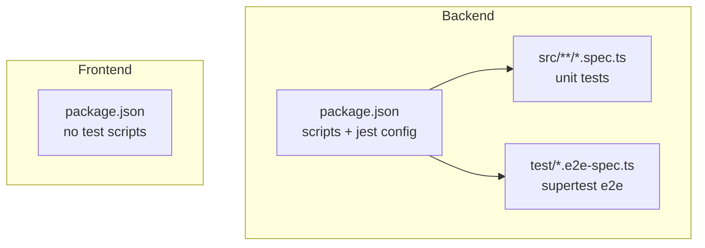
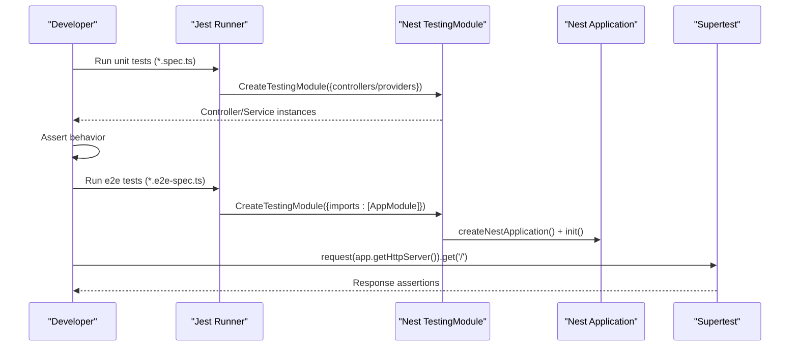
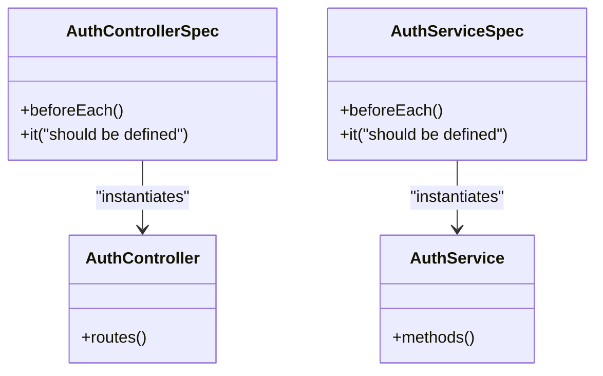
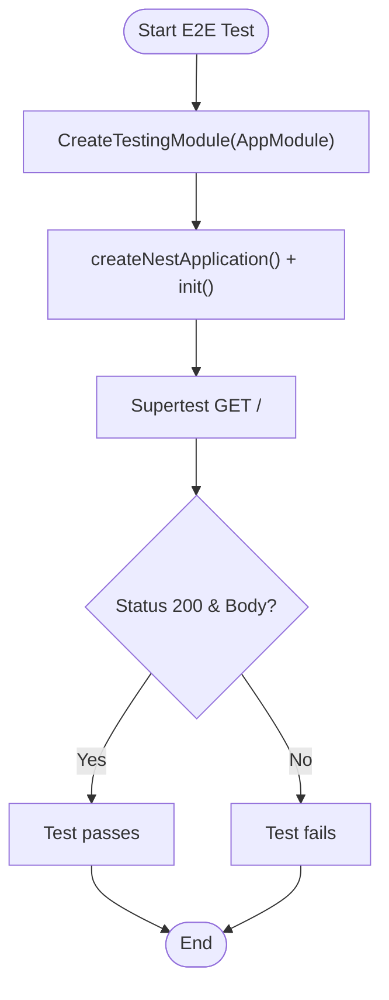
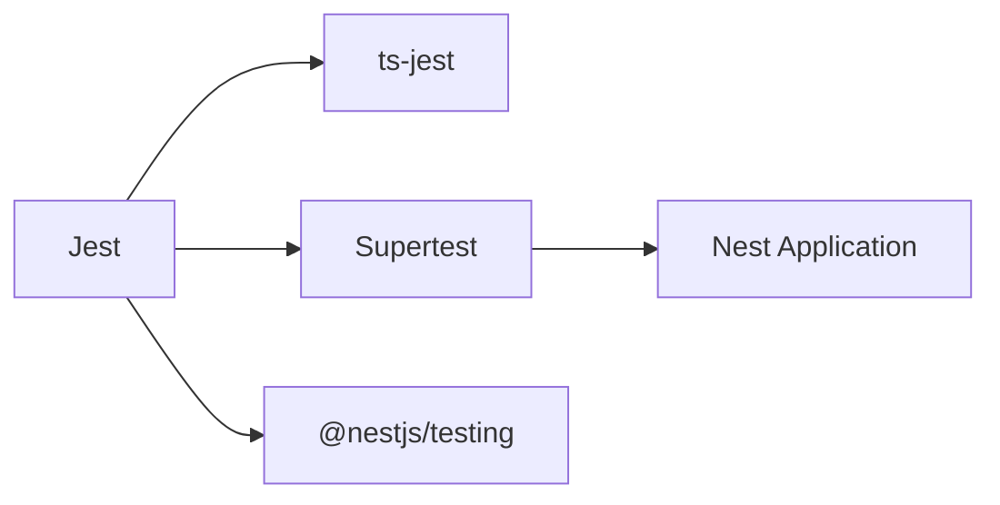

# Testing Strategy

<cite>
**Referenced Files in This Document**
- [package.json](file://apps/backend/package.json)
- [app.controller.spec.ts](file://apps/backend/src/app.controller.spec.ts)
- [auth.controller.spec.ts](file://apps/backend/src/auth/auth.controller.spec.ts)
- [auth.service.spec.ts](file://apps/backend/src/auth/auth.service.spec.ts)
- [app.e2e-spec.ts](file://apps/backend/test/app.e2e-spec.ts)
- [jest-e2e.json](file://apps/backend/test/jest-e2e.json)
</cite>

## Table of Contents
1. [Introduction](#introduction)
2. [Project Structure](#project-structure)
3. [Core Components](#core-components)
4. [Architecture Overview](#architecture-overview)
5. [Detailed Component Analysis](#detailed-component-analysis)
6. [Dependency Analysis](#dependency-analysis)
7. [Performance Considerations](#performance-considerations)
8. [Troubleshooting Guide](#troubleshooting-guide)
9. [Conclusion](#conclusion)

## Introduction
This document defines the testing strategy for the German Butcher e-commerce platform, covering unit tests for backend services and frontend components, integration tests for API endpoints and database operations, and end-to-end tests for critical user journeys. It explains test organization, naming conventions, mocking strategies, tools (Jest, Supertest), and provides guidance for real-time features, asynchronous operations, test data management, environment setup, CI pipelines, and performance/load testing.

## Project Structure
The repository is a monorepo with separate apps for backend and frontend:
- Backend (NestJS): Unit tests under src/**.spec.ts; E2E tests under test/*.e2e-spec.ts; Jest configuration in package.json; Supertest used for HTTP integration/E2E.
- Frontend (Next.js): No dedicated test framework or scripts are present in the current package configuration.

**Diagram sources**
- [package.json:8-21](file://apps/backend/package.json#L8-L21)
- [package.json:93-112](file://apps/backend/package.json#L93-L112)

**Section sources**
- [package.json:8-21](file://apps/backend/package.json#L8-L21)
- [package.json:93-112](file://apps/backend/package.json#L93-L112)

## Core Components
- Test runner: Jest (configured for TypeScript via ts-jest).
- HTTP testing: Supertest for API-level integration/E2E.
- NestJS testing utilities: @nestjs/testing for controller/service unit tests.
- Coverage: Jest coverage collection configured to output to ../coverage.

Key responsibilities:
- Unit tests validate isolated behavior of controllers and services using NestJS TestingModule.
- E2E tests spin up a full Nest application and assert HTTP responses via Supertest.

**Section sources**
- [package.json:8-21](file://apps/backend/package.json#L8-L21)
- [package.json:93-112](file://apps/backend/package.json#L93-L112)

## Architecture Overview
The backend testing architecture uses Jest as the orchestrator:
- Unit tests compile modules with minimal providers and assert service/controller logic.
- E2E tests bootstrap the entire AppModule and use Supertest to send HTTP requests against the running server.

**Diagram sources**
- [app.controller.spec.ts:1-22](file://apps/backend/src/app.controller.spec.ts#L1-L22)
- [app.e2e-spec.ts:1-24](file://apps/backend/test/app.e2e-spec.ts#L1-L24)

## Detailed Component Analysis

### Backend Unit Tests
- Organization: Each feature module typically includes controller and service spec files colocated with implementation.
- Naming: *.spec.ts pattern recognized by Jest.
- Setup: Use NestJS TestingModule to instantiate controllers/services with minimal dependencies.
- Example patterns:
  - Controller unit test scaffolding verifies controller instantiation and basic behavior.
  - Service unit test scaffolding verifies service instantiation.

**Diagram sources**
- [auth.controller.spec.ts:1-18](file://apps/backend/src/auth/auth.controller.spec.ts#L1-L18)
- [auth.service.spec.ts:1-18](file://apps/backend/src/auth/auth.service.spec.ts#L1-L18)

Guidelines for writing effective unit tests:
- Controllers:
  - Instantiate via TestingModule with only required providers.
  - Mock external services injected into controllers.
  - Validate route handlers return expected DTOs/status codes.
- Services:
  - Provide mocks for repositories, external clients, and third-party SDKs.
  - Assert business rules, transformations, and error handling paths.
- Guards/Interceptors/Pipes:
  - Test canActivate/intercept methods with mock Request/Response objects.
  - Verify metadata extraction and transformation logic.

**Section sources**
- [auth.controller.spec.ts:1-18](file://apps/backend/src/auth/auth.controller.spec.ts#L1-L18)
- [auth.service.spec.ts:1-18](file://apps/backend/src/auth/auth.service.spec.ts#L1-L18)

### Backend E2E Tests
- Organization: E2E specs live under test/ and are matched by jest-e2e.json.
- Execution: Bootstrap AppModule, initialize NestApplication, and issue HTTP requests via Supertest.
- Example: Root endpoint assertion demonstrates the standard E2E flow.

**Diagram sources**
- [app.e2e-spec.ts:1-24](file://apps/backend/test/app.e2e-spec.ts#L1-L24)
- [jest-e2e.json:1-9](file://apps/backend/test/jest-e2e.json#L1-L9)

Integration testing approaches:
- Database operations:
  - Use an in-memory or test database instance.
  - Seed deterministic fixtures before each test; clean up after.
  - Wrap transactions per test to ensure isolation.
- External API calls:
  - Mock HTTP clients (e.g., axios) or provider SDKs.
  - Stub network errors and timeouts to verify resilience.
- Payment processing:
  - Mock payment gateway responses and webhooks.
  - Validate idempotency, retries, and failure paths.

**Section sources**
- [app.e2e-spec.ts:1-24](file://apps/backend/test/app.e2e-spec.ts#L1-L24)
- [jest-e2e.json:1-9](file://apps/backend/test/jest-e2e.json#L1-L9)

### Frontend Testing
- Current state: The frontend package does not include a test framework or scripts in its configuration.
- Recommended approach:
  - Add a testing framework (e.g., Vitest or Jest with React Testing Library).
  - Organize tests alongside components (e.g., *.test.tsx).
  - Mock Next.js router, context providers, and API calls.
  - For E2E, consider Playwright or Cypress to cover critical user journeys.

[No sources needed since this section doesn't analyze specific source files]

### Real-Time Features and Asynchronous Operations
- WebSocket testing:
  - For NestJS WebSockets/Socket.IO, write integration tests that connect a client and assert events/messages.
  - Mock external event emitters and verify message routing.
- Async operations:
  - Use async/await and proper timeouts in tests.
  - Mock timers for time-dependent logic where appropriate.

[No sources needed since this section doesn't analyze specific source files]

## Dependency Analysis
The backend test stack depends on:
- Jest: Test runner and assertion library.
- ts-jest: TypeScript transformation for tests.
- Supertest: HTTP integration/E2E testing.
- @nestjs/testing: NestJS-specific testing utilities.

**Diagram sources**
- [package.json:83-91](file://apps/backend/package.json#L83-L91)
- [package.json:93-112](file://apps/backend/package.json#L93-L112)

**Section sources**
- [package.json:83-91](file://apps/backend/package.json#L83-L91)
- [package.json:93-112](file://apps/backend/package.json#L93-L112)

## Performance Considerations
- Keep unit tests fast and isolated; avoid heavy I/O.
- Parallelize test execution with Jest’s default concurrency.
- Limit E2E scope to critical flows; run full suites periodically.
- For load/performance testing:
  - Use k6 or Artillery to simulate high traffic scenarios.
  - Measure latency, throughput, and resource utilization.
  - Integrate performance budgets into CI to catch regressions.

[No sources needed since this section provides general guidance]

## Troubleshooting Guide
Common issues and resolutions:
- Module resolution errors:
  - Ensure moduleNameMapper aligns with project structure.
  - Confirm tsconfig paths match Jest expectations.
- TypeScript compilation in tests:
  - Verify ts-jest transformer is configured.
- Supertest failures:
  - Ensure app.init() completes before sending requests.
  - Check environment variables and DB connections for E2E.

**Section sources**
- [package.json:93-112](file://apps/backend/package.json#L93-L112)
- [app.e2e-spec.ts:9-16](file://apps/backend/test/app.e2e-spec.ts#L9-L16)

## Conclusion
The backend leverages Jest and Supertest for robust unit and E2E testing, with clear separation between unit specs and E2E specs. The frontend currently lacks a test setup; adopting a modern testing stack will strengthen confidence across the platform. Following the guidelines here ensures maintainable, reliable tests for controllers, services, guards, integrations, and critical user journeys.