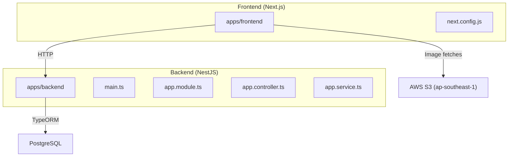
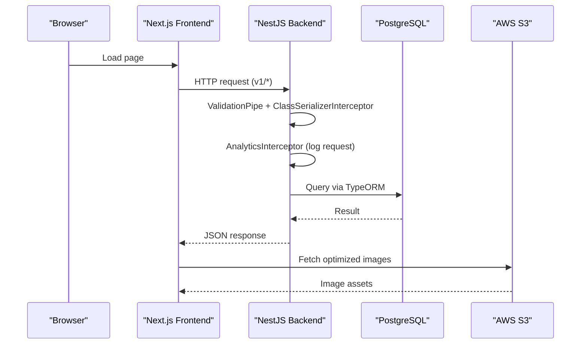
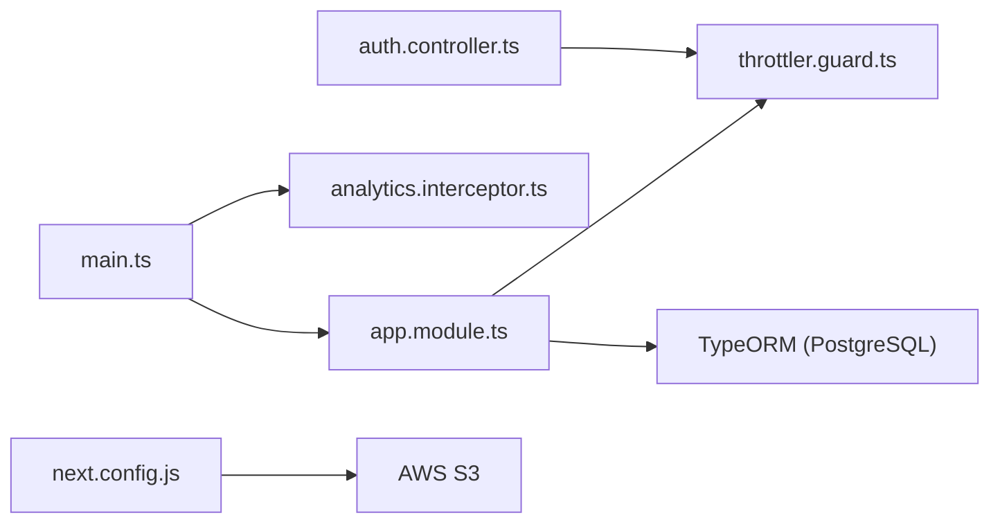

# Troubleshooting & FAQ

<cite>
**Referenced Files in This Document**
- [README.md](file://README.md)
- [docker-compose.yml](file://docker-compose.yml)
- [apps/backend/src/main.ts](file://apps/backend/src/main.ts)
- [apps/backend/src/app.module.ts](file://apps/backend/src/app.module.ts)
- [apps/backend/src/app.controller.ts](file://apps/backend/src/app.controller.ts)
- [apps/backend/src/app.service.ts](file://apps/backend/src/app.service.ts)
- [apps/backend/src/analytics/interceptors/analytics.interceptor.ts](file://apps/backend/src/analytics/interceptors/analytics.interceptor.ts)
- [apps/backend/src/analytics/dto/log-request.dto.ts](file://apps/backend/src/analytics/dto/log-request.dto.ts)
- [apps/backend/src/auth/auth.controller.ts](file://apps/backend/src/auth/auth.controller.ts)
- [apps/backend/src/common/guards/throttler.guard.ts](file://apps/backend/src/common/guards/throttler.guard.ts)
- [apps/backend/src/common/decorators/skip-throttle.decorator.ts](file://apps/backend/src/common/decorators/skip-throttle.decorator.ts)
- [apps/backend/scripts/create-location-table.js](file://apps/backend/scripts/create-location-table.js)
- [apps/frontend/next.config.js](file://apps/frontend/next.config.js)
</cite>

## Table of Contents
1. Introduction
2. Project Structure
3. Core Components
4. Architecture Overview
5. Detailed Component Analysis
6. Dependency Analysis
7. Performance Considerations
8. Troubleshooting Guide
9. Conclusion
10. Appendices

## Introduction
This document provides comprehensive troubleshooting and FAQ guidance for the German Butcher e-commerce platform across development, deployment, and production operations. It covers environment setup, database connectivity, API connectivity, performance bottlenecks, memory/resource issues, debugging techniques, log analysis, error tracking, known limitations, workarounds, compatibility matrices, configuration options, extension points, diagnostic tools, health checks, monitoring dashboards, escalation procedures, rollback/recovery strategies, and data restoration processes.

## Project Structure
The monorepo includes:
- Frontend: Next.js 16 application with App Router, static image optimization, and standalone output.
- Backend: NestJS 11 API with TypeORM/PostgreSQL, Swagger/OpenAPI, rate limiting, compression, security headers, and analytics interceptors.
- Orchestration: Docker Compose with health checks for both services.

**Diagram sources**
- [apps/frontend/next.config.js:14-35](file://apps/frontend/next.config.js#L14-L35)
- [apps/backend/src/main.ts:16-128](file://apps/backend/src/main.ts#L16-L128)
- [apps/backend/src/app.module.ts:93-105](file://apps/backend/src/app.module.ts#L93-L105)
- [apps/backend/src/app.controller.ts:1-12](file://apps/backend/src/app.controller.ts#L1-L12)
- [apps/backend/src/app.service.ts:1-11](file://apps/backend/src/app.service.ts#L1-L11)

**Section sources**
- [README.md:5-32](file://README.md#L5-L32)

## Core Components
- Backend bootstrap and middleware: body size limits, compression, helmet, CORS, global pipes/interceptors, versioning, Swagger UI toggling, proxy trust, shutdown hooks.
- Configuration and modules: ConfigModule env file selection, ThrottlerModule configuration, TypeORM connection via config service.
- Health endpoint: returns configured database host to validate backend startup and configuration.
- Analytics interceptor: logs request metrics per route with silent fail to avoid impacting API availability.
- Rate limiting: global throttler guards with optional skip metadata.
- Frontend image optimization: remote patterns for S3, cache TTL, strict CSP for images.

**Section sources**
- [apps/backend/src/main.ts:16-128](file://apps/backend/src/main.ts#L16-L128)
- [apps/backend/src/app.module.ts:63-105](file://apps/backend/src/app.module.ts#L63-L105)
- [apps/backend/src/app.controller.ts:1-12](file://apps/backend/src/app.controller.ts#L1-L12)
- [apps/backend/src/app.service.ts:1-11](file://apps/backend/src/app.service.ts#L1-L11)
- [apps/backend/src/analytics/interceptors/analytics.interceptor.ts:42-115](file://apps/backend/src/analytics/interceptors/analytics.interceptor.ts#L42-L115)
- [apps/backend/src/common/guards/throttler.guard.ts:1-27](file://apps/backend/src/common/guards/throttler.guard.ts#L1-L27)
- [apps/backend/src/common/decorators/skip-throttle.decorator.ts:1-4](file://apps/backend/src/common/decorators/skip-throttle.decorator.ts#L1-L4)
- [apps/frontend/next.config.js:14-35](file://apps/frontend/next.config.js#L14-L35)

## Architecture Overview
End-to-end request flow from frontend to backend, including analytics logging and error handling.

**Diagram sources**
- [apps/backend/src/main.ts:111-125](file://apps/backend/src/main.ts#L111-L125)
- [apps/backend/src/analytics/interceptors/analytics.interceptor.ts:58-115](file://apps/backend/src/analytics/interceptors/analytics.interceptor.ts#L58-L115)
- [apps/backend/src/app.module.ts:93-105](file://apps/backend/src/app.module.ts#L93-L105)
- [apps/frontend/next.config.js:14-35](file://apps/frontend/next.config.js#L14-L35)

## Detailed Component Analysis

### Backend Bootstrap and Middleware
Key responsibilities:
- Increase payload limits for checkout payloads.
- Enable compression and security headers.
- Configure CORS, global validation, serialization, and analytics interception.
- Set API versioning and Swagger UI based on environment variables.
- Trust reverse proxies for accurate client IP.
- Enable graceful shutdown hooks for pending analytics flush.

Operational notes:
- If large payloads are rejected, verify body parser limits.
- If CORS errors occur, ensure allowed origins are configured.
- If Swagger is unexpectedly enabled/disabled, check SWAGGER_ENABLED and NODE_ENV.

**Section sources**
- [apps/backend/src/main.ts:16-128](file://apps/backend/src/main.ts#L16-L128)

### Configuration and Database Connectivity
Responsibilities:
- Select environment files by NODE_ENV.
- Configure ThrottlerModule with multiple windows.
- Connect to PostgreSQL using DATABASE_HOST, DATABASE_PORT, DATABASE_USER, DATABASE_PASSWORD, DATABASE_NAME.

Common issues:
- Connection failures due to wrong credentials or network policies.
- Missing required environment variables.
- Production environments where synchronize is disabled require manual migrations or scripts.

Mitigations:
- Validate environment variables before starting.
- Use provided scripts to create missing tables when necessary.

**Section sources**
- [apps/backend/src/app.module.ts:63-105](file://apps/backend/src/app.module.ts#L63-L105)
- [apps/backend/scripts/create-location-table.js:1-66](file://apps/backend/scripts/create-location-table.js#L1-L66)

### Health Check Endpoint
Purpose:
- Returns the configured database host to confirm backend startup and configuration correctness.

Usage:
- Call GET /v1 to verify backend is running and configuration is loaded.

Limitations:
- Does not perform a live database connectivity test; it only reads a config value.

**Section sources**
- [apps/backend/src/app.controller.ts:1-12](file://apps/backend/src/app.controller.ts#L1-L12)
- [apps/backend/src/app.service.ts:1-11](file://apps/backend/src/app.service.ts#L1-L11)

### Analytics Interceptor and Request Logging
Behavior:
- Tracks selected routes, records method, status code, response time, user context, IP, user agent, referer, and request path.
- Logs silently on failure to avoid breaking API responses.

Diagnostics:
- Use top endpoints and analytics queries to identify slow or failing routes.
- Inspect logs for failed analytics entries.

Data model:
- LogRequestDto defines required fields for analytics persistence.

**Section sources**
- [apps/backend/src/analytics/interceptors/analytics.interceptor.ts:42-115](file://apps/backend/src/analytics/interceptors/analytics.interceptor.ts#L42-L115)
- [apps/backend/src/analytics/dto/log-request.dto.ts:1-45](file://apps/backend/src/analytics/dto/log-request.dto.ts#L1-L45)

### Rate Limiting and Throttling
Configuration:
- Global throttler windows: short (1 min), medium (5 min), long (1 hour).
- Custom guard supports skipping throttle via metadata decorator.

Auth endpoints:
- Mobile login and OTP verification have explicit throttle decorators due to shared IP behavior behind server actions.

Troubleshooting:
- If legitimate traffic is blocked, adjust limits or use SkipThrottle where appropriate.
- Verify that custom throttler guard is registered globally.

**Section sources**
- [apps/backend/src/app.module.ts:70-92](file://apps/backend/src/app.module.ts#L70-L92)
- [apps/backend/src/common/guards/throttler.guard.ts:1-27](file://apps/backend/src/common/guards/throttler.guard.ts#L1-L27)
- [apps/backend/src/common/decorators/skip-throttle.decorator.ts:1-4](file://apps/backend/src/common/decorators/skip-throttle.decorator.ts#L1-L4)
- [apps/backend/src/auth/auth.controller.ts:235-277](file://apps/backend/src/auth/auth.controller.ts#L235-L277)

### Frontend Image Optimization and Remote Patterns
Features:
- Strict content security policy for images.
- Remote patterns for AWS S3 buckets in ap-southeast-1.
- Long cache TTL to reduce upstream fetches.

Issues:
- If images fail to load, verify remotePatterns and bucket accessibility.
- If caching causes stale images, consider adjusting minimumCacheTTL.

**Section sources**
- [apps/frontend/next.config.js:14-35](file://apps/frontend/next.config.js#L14-L35)

## Dependency Analysis
High-level dependencies between core components:

**Diagram sources**
- [apps/backend/src/main.ts:16-128](file://apps/backend/src/main.ts#L16-L128)
- [apps/backend/src/app.module.ts:63-105](file://apps/backend/src/app.module.ts#L63-L105)
- [apps/backend/src/analytics/interceptors/analytics.interceptor.ts:42-115](file://apps/backend/src/analytics/interceptors/analytics.interceptor.ts#L42-L115)
- [apps/backend/src/common/guards/throttler.guard.ts:1-27](file://apps/backend/src/common/guards/throttler.guard.ts#L1-L27)
- [apps/backend/src/auth/auth.controller.ts:235-277](file://apps/backend/src/auth/auth.controller.ts#L235-L277)
- [apps/frontend/next.config.js:14-35](file://apps/frontend/next.config.js#L14-L35)

**Section sources**
- [apps/backend/src/main.ts:16-128](file://apps/backend/src/main.ts#L16-L128)
- [apps/backend/src/app.module.ts:63-105](file://apps/backend/src/app.module.ts#L63-L105)

## Performance Considerations
- Payload size: Body parser limits increased to 2MB to accommodate checkout payloads. Monitor if larger payloads are needed.
- Compression: Enabled for JSON responses to reduce bandwidth.
- Caching: Frontend image cache TTL set to 31 days for immutable S3 objects.
- Rate limiting: Tune throttler windows and limits according to traffic patterns.
- Analytics overhead: Interceptor logs asynchronously with silent fail to minimize impact.

Recommendations:
- Profile slow endpoints using analytics top endpoints.
- Adjust throttle limits per endpoint using decorators or skip metadata.
- Monitor S3 latency and consider CDN placement if needed.

[No sources needed since this section provides general guidance]

## Troubleshooting Guide

### Environment Setup Problems
Symptoms:
- Port conflicts during development.
- Missing environment variables causing runtime errors.
- Docker containers failing to start.

Resolutions:
- Kill processes occupying ports 3000 or 3002.
- Ensure .env files exist and contain required variables.
- Rebuild Docker images and clear caches if build fails.

**Section sources**
- [README.md:282-310](file://README.md#L282-L310)

### Database Connection Issues
Symptoms:
- Application cannot connect to PostgreSQL.
- Migrations or schema changes fail in production.

Resolutions:
- Verify DATABASE_HOST, DATABASE_PORT, DATABASE_USER, DATABASE_PASSWORD, DATABASE_NAME.
- Confirm network access and firewall rules.
- For production without synchronize, run migration scripts or table creation scripts.

**Section sources**
- [apps/backend/src/app.module.ts:93-105](file://apps/backend/src/app.module.ts#L93-L105)
- [apps/backend/scripts/create-location-table.js:1-66](file://apps/backend/scripts/create-location-table.js#L1-L66)

### API Connectivity Errors
Symptoms:
- CORS errors from frontend.
- Requests blocked by rate limiting.
- Large payloads rejected.

Resolutions:
- Configure CORS_ORIGINS appropriately.
- Adjust throttle limits or apply SkipThrottle where necessary.
- Verify body parser limits and request sizes.

**Section sources**
- [apps/backend/src/main.ts:89-128](file://apps/backend/src/main.ts#L89-L128)
- [apps/backend/src/common/guards/throttler.guard.ts:1-27](file://apps/backend/src/common/guards/throttler.guard.ts#L1-L27)
- [apps/backend/src/common/decorators/skip-throttle.decorator.ts:1-4](file://apps/backend/src/common/decorators/skip-throttle.decorator.ts#L1-L4)
- [apps/backend/src/auth/auth.controller.ts:235-277](file://apps/backend/src/auth/auth.controller.ts#L235-L277)

### Performance Bottlenecks
Symptoms:
- Slow endpoints under load.
- High response times.

Resolutions:
- Use analytics top endpoints to identify hotspots.
- Optimize database queries and add indexes.
- Tune throttler windows and limits.
- Review image loading patterns and S3 latency.

**Section sources**
- [apps/backend/src/analytics/interceptors/analytics.interceptor.ts:42-115](file://apps/backend/src/analytics/interceptors/analytics.interceptor.ts#L42-L115)
- [apps/frontend/next.config.js:14-35](file://apps/frontend/next.config.js#L14-L35)

### Memory Leaks and Resource Exhaustion
Symptoms:
- Gradual memory growth.
- Out-of-memory crashes.

Resolutions:
- Enable Node.js heap dumps and analyze with profiling tools.
- Reduce unnecessary object retention in interceptors and services.
- Monitor container resource limits and adjust accordingly.
- Ensure analytics logging does not accumulate unbounded data.

[No sources needed since this section provides general guidance]

### Debugging Techniques
Frontend:
- Use browser DevTools Network tab to inspect requests to NEXT_PUBLIC_API_URL.
- Validate image fetches against configured remotePatterns.

Backend:
- Enable verbose logging and review console output.
- Use Swagger UI at /docs to test endpoints interactively.

**Section sources**
- [apps/frontend/next.config.js:14-35](file://apps/frontend/next.config.js#L14-L35)
- [apps/backend/src/main.ts:42-87](file://apps/backend/src/main.ts#L42-L87)

### Log Analysis Strategies
- Analyze analytics logs for endpoint performance and error rates.
- Correlate request IDs and timestamps across services.
- Filter logs by user agent, IP, and authentication status.

**Section sources**
- [apps/backend/src/analytics/dto/log-request.dto.ts:1-45](file://apps/backend/src/analytics/dto/log-request.dto.ts#L1-L45)
- [apps/backend/src/analytics/interceptors/analytics.interceptor.ts:58-115](file://apps/backend/src/analytics/interceptors/analytics.interceptor.ts#L58-L115)

### Error Tracking Approaches
- Centralize error logs and forward to external systems.
- Track analytics failures separately to avoid masking real errors.
- Implement structured logging with correlation IDs.

[No sources needed since this section provides general guidance]

### Known Limitations and Workarounds
- Shared IP behavior behind server actions affects per-user throttling for mobile login and OTP verification.
- Production environments may disable synchronize; use scripts to create missing tables.

Workarounds:
- Apply SkipThrottle selectively for internal or batch endpoints.
- Run idempotent scripts to ensure schema readiness.

**Section sources**
- [apps/backend/src/auth/auth.controller.ts:235-277](file://apps/backend/src/auth/auth.controller.ts#L235-L277)
- [apps/backend/scripts/create-location-table.js:1-66](file://apps/backend/scripts/create-location-table.js#L1-L66)

### Compatibility Matrices
- Node.js: Frontend uses Node 22 Alpine; Backend uses Node 20 Alpine in Docker.
- Frameworks: Next.js 16, NestJS 11, TypeScript 6.
- Database: PostgreSQL with TypeORM.

**Section sources**
- [README.md:218-223](file://README.md#L218-L223)

### Configuration Options
- Body parser limits: json and urlencoded set to 2MB.
- CORS origins: configurable via environment variable.
- Swagger UI: controlled by SWAGGER_ENABLED and related variables.
- Image optimization: remotePatterns and cache TTL configured in next.config.js.

**Section sources**
- [apps/backend/src/main.ts:20-35](file://apps/backend/src/main.ts#L20-L35)
- [apps/backend/src/main.ts:89-128](file://apps/backend/src/main.ts#L89-L128)
- [apps/frontend/next.config.js:14-35](file://apps/frontend/next.config.js#L14-L35)

### Extension Points
- Add new analytics routes by updating allowedRoutes in the analytics interceptor.
- Extend throttling rules via decorators or metadata.
- Integrate additional storage providers by extending S3 usage patterns.

**Section sources**
- [apps/backend/src/analytics/interceptors/analytics.interceptor.ts:42-115](file://apps/backend/src/analytics/interceptors/analytics.interceptor.ts#L42-L115)
- [apps/backend/src/common/decorators/skip-throttle.decorator.ts:1-4](file://apps/backend/src/common/decorators/skip-throttle.decorator.ts#L1-L4)

### Diagnostic Tools and Health Checks
- Backend health: GET /v1 returns configured database host.
- Docker health checks:
  - Frontend: http://localhost:3002
  - Backend: http://localhost:3000/v1

**Section sources**
- [apps/backend/src/app.controller.ts:1-12](file://apps/backend/src/app.controller.ts#L1-L12)
- [apps/backend/src/app.service.ts:1-11](file://apps/backend/src/app.service.ts#L1-L11)
- [docker-compose.yml:19-24](file://docker-compose.yml#L19-L24)
- [docker-compose.yml:41-46](file://docker-compose.yml#L41-L46)

### Monitoring Dashboards
- Use analytics endpoints to retrieve top endpoints and aggregate metrics.
- Visualize response times and error rates over time.

**Section sources**
- [apps/backend/src/analytics/interceptors/analytics.interceptor.ts:58-115](file://apps/backend/src/analytics/interceptors/analytics.interceptor.ts#L58-L115)

### Escalation Procedures
- For critical outages:
  - Check Docker health and service logs.
  - Validate environment variables and database connectivity.
  - Review analytics logs for spikes in errors or latency.
  - Engage support channels listed in the repository README.

**Section sources**
- [README.md:383-388](file://README.md#L383-L388)

### Rollback Procedures
- Revert to previous Docker images or deployments.
- Restore environment variables to prior versions.
- Re-run migrations cautiously; prefer backward-compatible changes.

[No sources needed since this section provides general guidance]

### Recovery Strategies and Data Restoration
- Use database backups to restore state after incidents.
- Validate schema integrity using provided scripts if needed.
- Re-seed reference data where applicable.

**Section sources**
- [apps/backend/scripts/create-location-table.js:1-66](file://apps/backend/scripts/create-location-table.js#L1-L66)

## Conclusion
This guide consolidates common issues, diagnostics, and operational practices for the German Butcher platform. By leveraging built-in health checks, analytics logging, rate limiting, and Docker health probes, teams can proactively detect and resolve issues. Follow the troubleshooting steps, tune configurations for your environment, and escalate promptly when critical problems arise.

[No sources needed since this section summarizes without analyzing specific files]

## Appendices

### Frequently Asked Questions
- How do I increase payload size limits?
  - The backend sets body parser limits to 2MB for JSON and URL-encoded payloads.
- Why am I getting CORS errors?
  - Configure CORS_ORIGINS to include your frontend domain(s).
- How do I disable Swagger in production?
  - Ensure SWAGGER_ENABLED is false or NODE_ENV is production without enabling it explicitly.
- How do I verify the backend is healthy?
  - Call GET /v1; it returns the configured database host.
- How do I handle missing tables in production?
  - Run the provided script to create required tables idempotently.

**Section sources**
- [apps/backend/src/main.ts:20-35](file://apps/backend/src/main.ts#L20-L35)
- [apps/backend/src/main.ts:89-128](file://apps/backend/src/main.ts#L89-L128)
- [apps/backend/src/app.controller.ts:1-12](file://apps/backend/src/app.controller.ts#L1-L12)
- [apps/backend/scripts/create-location-table.js:1-66](file://apps/backend/scripts/create-location-table.js#L1-L66)